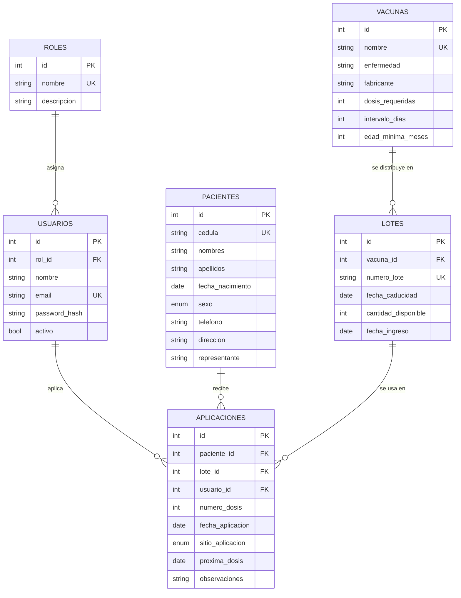

# Sistema de Control de Vacunación

**Estudiante:** Javier Alexander Carrera Rodriguez · **N.º 6** · Rama `estudiante-06-javier-carrera`
**Asignatura:** Desarrollo de Aplicaciones Web: Frontend y Backend

Aplicación web completa para registrar pacientes, administrar el catálogo e inventario de vacunas y llevar el historial (carnet) de vacunación de cada persona, con control de dosis, intervalos, edades mínimas, stock y caducidad.

| Capa | Tecnología |
|------|-----------|
| Base de datos | MySQL 8 (InnoDB, utf8mb4) |
| Backend | Node.js + Express 5, API REST, `mysql2` |
| Seguridad | JWT (`jsonwebtoken`) + contraseñas con hash `bcryptjs` + roles |
| Frontend | HTML5, CSS3 y JavaScript (módulos ES, `fetch`), sin frameworks |

---

## 1. Análisis del problema

Un centro de salud necesita dejar de llevar el control de vacunas en papel. Los problemas a resolver son:
saber **qué vacunas recibió cada paciente y cuáles le faltan**, **cuándo le toca la siguiente dosis**,
**cuánto stock hay de cada vacuna y qué lotes están por caducar**, y **quién aplicó cada dosis** (trazabilidad).

### Actores
- **Administrador (ADMIN):** gestiona usuarios, catálogo de vacunas y lotes; puede eliminar registros.
- **Enfermería (ENFERMERO):** registra/edita pacientes y registra las vacunas aplicadas; consulta catálogo e inventario.

### Requerimientos funcionales
| Código | Requerimiento |
|-------|---------------|
| RF01 | Iniciar sesión con correo y contraseña; cerrar sesión. |
| RF02 | Gestionar usuarios (CRUD) y activarlos/desactivarlos — solo ADMIN. |
| RF03 | Gestionar pacientes (CRUD) con cédula ecuatoriana válida y búsqueda por cédula/nombre. |
| RF04 | Gestionar el catálogo de vacunas (CRUD): dosis requeridas, intervalo entre dosis y edad mínima. |
| RF05 | Gestionar lotes (CRUD): número, cantidad disponible, fechas de ingreso y caducidad. |
| RF06 | Registrar la aplicación de una vacuna: paciente, lote, fecha, sitio y observaciones. |
| RF07 | Calcular automáticamente el número de dosis y la fecha de la próxima dosis. |
| RF08 | Descontar el stock del lote al aplicar y devolverlo si se elimina el registro. |
| RF09 | Consultar el carnet de vacunación: historial y estado de cada esquema. |
| RF10 | Panel con indicadores, próximas dosis/atrasadas y alertas de lotes (caducados, por caducar, stock bajo). |

### Reglas de negocio (validadas en el backend)
1. No se aplica una vacuna con un lote **caducado** o **sin stock**.
2. No se aplica antes de la **edad mínima** de la vacuna ni antes del nacimiento.
3. No se superan las **dosis requeridas** del esquema.
4. Entre dosis debe pasar el **intervalo mínimo** de días.
5. La fecha de aplicación **no puede ser futura**.
6. Un paciente **menor de 18 años** debe tener **representante**.
7. No se eliminan pacientes, lotes, vacunas o usuarios que tengan **historial** (integridad referencial).
8. Solo se elimina la **última** dosis de un esquema (para no dejar "huecos" en la numeración).

---

## 2. Diseño de la base de datos

### Identificación de entidades (justificación)
El modelo tiene **6 entidades**: 2 de seguridad (**roles**, **usuarios**) y 4 del negocio (**pacientes**, **vacunas**, **lotes**, **aplicaciones**).

| Entidad | ¿Por qué existe? |
|--------|-----------------|
| **roles** | Define los perfiles de acceso (ADMIN, ENFERMERO) con su descripción. Al ser tabla y no un texto repetido en cada usuario, se evita redundancia y se garantiza por FK que un usuario solo tenga un rol válido. |
| **usuarios** | La seguridad exige saber quién entra y con qué rol; además cada dosis guarda quién la aplicó. |
| **pacientes** | Es la persona a quien se le lleva el carnet. Datos propios que no dependen de otra entidad. |
| **vacunas** | Catálogo con las *reglas del esquema* (dosis, intervalo, edad mínima). Si estuvieran en cada aplicación se repetirían miles de veces. |
| **lotes** | Una misma vacuna llega en varios lotes con distinta caducidad y cantidad. Separarlo permite controlar inventario y saber qué lote recibió cada paciente (trazabilidad ante una alerta sanitaria). |
| **aplicaciones** | Es el **hecho** que el sistema registra. Resuelve la relación **N:M** entre pacientes y vacunas y guarda los atributos propios del evento (dosis, fecha, sitio). |

### Relaciones
- **roles 1 — N usuarios**: un rol lo tienen muchos usuarios; cada usuario tiene un solo rol.
- **vacunas 1 — N lotes**: una vacuna tiene muchos lotes; un lote pertenece a una sola vacuna.
- **pacientes 1 — N aplicaciones**: un paciente recibe muchas dosis.
- **lotes 1 — N aplicaciones**: de un lote se aplican muchas dosis.
- **usuarios 1 — N aplicaciones**: un profesional aplica muchas dosis.
- **pacientes N — M vacunas**, resuelta por *aplicaciones* (vía lote).

> **Decisión clave:** `aplicaciones` se relaciona con `lotes` y **no** guarda `vacuna_id`. La vacuna se obtiene por `lotes.vacuna_id`. Guardar ambos sería redundante y podría quedar inconsistente (un registro diciendo vacuna A con un lote de la vacuna B). Así la base cumple **3FN**.

### Diagrama Entidad-Relación



### Diagrama de tablas (modelo físico)

| Tabla | Columna | Tipo | Restricciones |
|-------|---------|------|---------------|
| **roles** | id | INT | **PK**, AUTO_INCREMENT |
| | nombre | VARCHAR(30) | NOT NULL, **UNIQUE** |
| | descripcion | VARCHAR(150) | NULL |
| **usuarios** | id | INT | **PK**, AUTO_INCREMENT |
| | rol_id | INT | **FK → roles.id** (RESTRICT) |
| | nombre | VARCHAR(100) | NOT NULL |
| | email | VARCHAR(120) | NOT NULL, **UNIQUE** |
| | password_hash | VARCHAR(255) | NOT NULL (hash bcrypt) |
| | activo | TINYINT(1) | NOT NULL, DEFAULT 1 |
| | creado_en | TIMESTAMP | DEFAULT CURRENT_TIMESTAMP |
| **pacientes** | id | INT | **PK** |
| | cedula | CHAR(10) | NOT NULL, **UNIQUE** |
| | nombres / apellidos | VARCHAR(80) | NOT NULL |
| | fecha_nacimiento | DATE | NOT NULL |
| | sexo | ENUM('M','F') | NOT NULL |
| | telefono | VARCHAR(15) | NULL |
| | direccion | VARCHAR(200) | NULL |
| | representante | VARCHAR(120) | NULL (obligatorio en la app si es menor) |
| **vacunas** | id | INT | **PK** |
| | nombre | VARCHAR(80) | NOT NULL, **UNIQUE** |
| | enfermedad | VARCHAR(150) | NOT NULL |
| | fabricante | VARCHAR(80) | NULL |
| | dosis_requeridas | TINYINT | CHECK 1–10 |
| | intervalo_dias | SMALLINT | CHECK ≥ 0 |
| | edad_minima_meses | SMALLINT | CHECK ≥ 0 |
| | descripcion | VARCHAR(300) | NULL |
| **lotes** | id | INT | **PK** |
| | vacuna_id | INT | **FK → vacunas.id** (RESTRICT) |
| | numero_lote | VARCHAR(40) | NOT NULL, **UNIQUE** |
| | fecha_caducidad | DATE | NOT NULL |
| | cantidad_disponible | INT | CHECK ≥ 0 |
| | fecha_ingreso | DATE | DEFAULT CURRENT_DATE |
| **aplicaciones** | id | INT | **PK** |
| | paciente_id | INT | **FK → pacientes.id** (RESTRICT) |
| | lote_id | INT | **FK → lotes.id** (RESTRICT) |
| | usuario_id | INT | **FK → usuarios.id** (RESTRICT) |
| | numero_dosis | TINYINT | CHECK ≥ 1 |
| | fecha_aplicacion | DATE | NOT NULL |
| | sitio_aplicacion | ENUM(6 sitios) | NOT NULL |
| | proxima_dosis | DATE | NULL = esquema completo |
| | observaciones | VARCHAR(300) | NULL |

Índices adicionales: `pacientes(apellidos, nombres)`, `aplicaciones(paciente_id, fecha_aplicacion)`, `aplicaciones(proxima_dosis)`, `lotes(fecha_caducidad)`.

---

## 3. Seguridad y control de usuarios
- Contraseñas guardadas como **hash bcrypt** (costo 10), nunca en texto plano; la API **nunca** devuelve `password_hash`.
- Login devuelve un **JWT** firmado con `JWT_SECRET` y con expiración (8 h). El frontend lo envía en `Authorization: Bearer <token>`.
- Middleware `autenticar` (¿quién es?) y `autorizar('ADMIN')` (¿qué puede hacer?). Respuestas **401** sin token/expirado y **403** sin permiso.
- El mismo mensaje para "usuario no existe" y "clave incorrecta" (no revela correos registrados). Usuarios desactivados no pueden ingresar.
- **Consultas parametrizadas** (`?`) en todo `mysql2` → protección contra **inyección SQL**.
- Escape de HTML en el frontend (`esc()`) → protección contra **XSS**.
- Validación en **frontend y backend** (el backend nunca confía en el cliente).

### Matriz de permisos
| Recurso | Consultar | Crear / Editar | Eliminar |
|--------|-----------|----------------|---------|
| Usuarios | ADMIN | ADMIN | ADMIN |
| Pacientes | Todos | Todos | ADMIN |
| Vacunas / Lotes | Todos | ADMIN | ADMIN |
| Aplicaciones | Todos | Todos | ADMIN |

---

## 4. API REST

Base: `http://localhost:3000/api` · Formato JSON · Errores: `{ "error": "...", "detalles": ["..."] }`

| Método | Endpoint | Descripción | Código éxito |
|-------|----------|-------------|--------------|
| POST | `/auth/login` | Iniciar sesión → `{ token, usuario }` | 200 |
| GET | `/auth/perfil` | Datos del usuario del token | 200 |
| GET | `/roles` | Listar roles (para asignar a usuarios) — ADMIN | 200 |
| GET / POST | `/usuarios` | Listar / crear usuario | 200 / 201 |
| GET / PUT / DELETE | `/usuarios/:id` | Obtener / actualizar / eliminar | 200 / 200 / 204 |
| GET / POST | `/pacientes?q=` | Listar (búsqueda) / crear | 200 / 201 |
| GET / PUT / DELETE | `/pacientes/:id` | Obtener / actualizar / eliminar | 200 / 200 / 204 |
| GET | `/pacientes/:id/carnet` | Historial + estado del esquema | 200 |
| GET / POST | `/vacunas` | Listar (con stock vigente) / crear | 200 / 201 |
| GET / PUT / DELETE | `/vacunas/:id` | Obtener / actualizar / eliminar | 200 / 200 / 204 |
| GET / POST | `/lotes?vacuna_id=&vigentes=1` | Listar (filtros) / crear | 200 / 201 |
| GET / PUT / DELETE | `/lotes/:id` | Obtener / actualizar / eliminar | 200 / 200 / 204 |
| GET / POST | `/aplicaciones?paciente_id=&desde=&hasta=` | Listar / registrar dosis | 200 / 201 |
| GET / PUT / DELETE | `/aplicaciones/:id` | Obtener / actualizar / eliminar | 200 / 200 / 204 |
| GET | `/reportes/resumen` | Indicadores del panel | 200 |

Códigos de error usados: **400** datos inválidos · **401** sin sesión · **403** sin permiso · **404** no existe · **409** conflicto con reglas o integridad (duplicado, sin stock, esquema completo, registro con historial) · **500** error interno.

Ejemplos de peticiones listos para probar: [docs/pruebas.http](docs/pruebas.http).

---

## 5. Estructura del proyecto

```
├── database/
│   ├── 01_schema.sql          # creación de BD, tablas, PK, FK, CHECK, índices
│   └── 02_datos.sql           # datos de prueba (usuarios, vacunas, lotes, pacientes, dosis)
├── backend/
│   ├── .env.example           # configuración (copiar como .env)
│   └── src/
│       ├── server.js          # arranque: verifica BD y levanta el servidor
│       ├── app.js             # middlewares, rutas y archivos estáticos
│       ├── config/db.js       # pool de conexiones MySQL
│       ├── middleware/        # auth.js (JWT y roles), errorHandler.js
│       ├── routes/index.js    # todos los endpoints
│       ├── controllers/       # lógica de cada recurso
│       └── utils/             # validaciones y HttpError
├── frontend/
│   ├── index.html             # login
│   ├── app.html               # aplicación (SPA con rutas #/...)
│   ├── css/estilos.css
│   └── js/
│       ├── api.js             # cliente fetch + token
│       ├── utils.js           # validaciones, escape XSS, formatos
│       ├── modal.js           # formulario modal reutilizable
│       ├── app.js             # sesión y enrutador
│       └── modulos/           # inicio, pacientes, aplicaciones, vacunas, lotes, usuarios
└── docs/
    ├── DEFENSA.md             # guía de preguntas para la defensa
    └── pruebas.http           # pruebas de la API
```

---

## 6. Instalación y ejecución

**Requisitos:** Node.js 18+ y MySQL 8+.

1. **Base de datos** — abra *MySQL Command Line Client* (o Workbench), ingrese la contraseña de root y ejecute en orden:
   ```sql
   source C:/Users/alexc/Desktop/Programacion WEB/examen-interciclo/database/01_schema.sql
   source C:/Users/alexc/Desktop/Programacion WEB/examen-interciclo/database/02_datos.sql
   ```
2. **Backend**
   ```bash
   cd backend
   copy .env.example .env      # en Linux/Mac: cp .env.example .env
   # edite .env: ponga su DB_PASSWORD de MySQL y cambie JWT_SECRET
   npm install
   npm start
   ```
   Debe mostrar `Conectado a MySQL` y `API escuchando en http://localhost:3000/api`.
3. **Frontend** — abra **http://localhost:3000** (lo sirve el mismo backend).
   También funciona con Live Server de VS Code, porque la API tiene CORS habilitado.

### Usuarios de prueba
Las credenciales de prueba están documentadas en el encabezado de `database/02_datos.sql` (un ADMIN y un usuario de enfermería).

---

## 7. Pruebas realizadas
| Caso | Resultado esperado |
|------|-------------------|
| Login con datos vacíos | 400 con lista de errores; el formulario los muestra |
| Petición sin token | 401 "Debe iniciar sesión" |
| ENFERMERO intenta crear una vacuna | 403 |
| Registrar paciente con cédula inválida | Bloqueado en el frontend y 400 en el backend |
| Registrar paciente con cédula repetida | 409 "Ya existe un registro..." |
| Menor de edad sin representante | 400 |
| Aplicar vacuna con lote caducado (`COV-2026-044`) | No aparece en el selector; la API responde 409 |
| Aplicar dosis antes del intervalo mínimo | 409 con la fecha mínima permitida |
| Aplicar dosis cuando el esquema está completo | 409 "ya completó el esquema" |
| Registrar dosis | 201; stock del lote −1; próxima dosis calculada |
| Eliminar dosis | 204; stock del lote +1 |
| Eliminar paciente con historial | 409 (integridad referencial) |
| JSON malformado | 400 "El cuerpo de la petición no es un JSON válido" |
