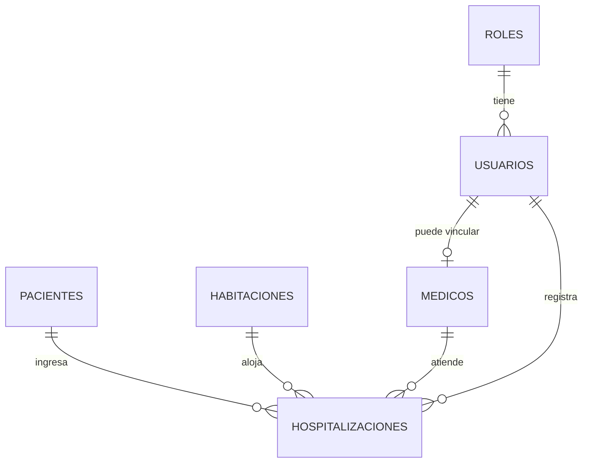

# Examen interciclo — Control de hospitalización

Sistema web para registrar pacientes, habitaciones y cada estancia hospitalaria. El frontend en Angular consume una API REST; la API guarda los datos en SQLite.

## Cómo ejecutarlo

Requiere Node.js 22.

```bash
npm run install:all
npm run dev
```

- Frontend: http://localhost:4200
- API: http://localhost:3000/api/health

Si la base queda en un estado raro durante las pruebas:

```bash
npm run reset
```

Vuelva a iniciar la API. El archivo `backend/data/hospital.db` se vuelve a crear con los datos de demostración.

## Cuentas

| Rol | Correo | Contraseña | Qué puede hacer |
| --- | --- | --- | --- |
| Administrador | admin@hospital.local | Admin123 | Todo, incluidos usuarios y eliminaciones |
| Médico | medico@hospital.local | Medico123 | Ver catálogos, editar la estancia y dar el alta |
| Recepción | recepcion@hospital.local | Recepcion123 | Registrar pacientes y abrir un ingreso |

La cuenta médica corresponde a la doctora Ana Torres. Sus estancias activas se marcan como "A mi cargo".

## Por qué estas entidades

El ingreso no es un dato fijo del paciente: la misma persona puede hospitalizarse varias veces y cada vez ocupa una cama distinta. Por eso la hospitalización es una entidad propia y no una columna de `pacientes`.



| Tabla | Para qué existe | Relaciones |
| --- | --- | --- |
| roles | Separar administrador, médico y recepción | 1:N con usuarios |
| usuarios | Entrar al sistema y dejar rastro de quién registró el ingreso | N:1 con roles |
| pacientes | La persona, independiente de cuántas veces ingrese | 1:N con hospitalizaciones |
| medicos | El responsable clínico. Puede tener cuenta, pero la ficha existe aunque no entre al sistema | 1:N con hospitalizaciones; 0..1 usuario |
| habitaciones | La cama es el recurso escaso: disponible, ocupada o en mantenimiento | 1:N con hospitalizaciones |
| hospitalizaciones | El hecho del ingreso: diagnóstico, fechas, alta y cama | N:1 paciente, habitación y médico |

Las claves y las reglas están en `database/schema.sql`. Consultas de apoyo para la defensa: `database/consultas.sql`.

## Reglas que protege la API

- Un paciente no puede tener dos hospitalizaciones activas.
- No se asigna una habitación ocupada o en mantenimiento.
- Al crear el ingreso, la habitación pasa a `OCUPADA`.
- Al dar el alta, la habitación vuelve a `DISPONIBLE`.
- Si la estancia sigue activa, se puede trasladar a otra cama libre.
- No se elimina un paciente, médico o habitación si ya tienen historial.
- La cédula se valida con el dígito verificador ecuatoriano, en el formulario y otra vez en la API.

## API REST

Todas las rutas, excepto el login y `/api/health`, piden `Authorization: Bearer <token>`.

| Método y ruta | Roles | Uso |
| --- | --- | --- |
| POST /api/auth/login | Público | Devuelve el JWT y el perfil |
| GET /api/auth/perfil | Autenticado | Datos de la sesión |
| GET /api/dashboard | Autenticado | Censo y últimos movimientos |
| GET/POST/PUT/DELETE /api/pacientes | Lectura: todos. Escritura: admin y recepción. Borrado: admin | CRUD de pacientes |
| GET/POST/PUT/DELETE /api/medicos | Lectura: todos. Cambios: admin | CRUD de médicos |
| GET/POST/PUT/DELETE /api/habitaciones | Lectura: todos. Cambios: admin | CRUD de camas |
| GET/POST/PUT/DELETE /api/hospitalizaciones | Crear: los tres roles. Editar y alta: admin y médico. Borrar: admin | Estancias |
| POST /api/hospitalizaciones/:id/alta | Admin y médico | Cierra la estancia y libera la cama |
| GET/POST/PUT/DELETE /api/usuarios | Admin | Cuentas y roles |

Los listados aceptan `?q=` para buscar. Habitaciones y hospitalizaciones también aceptan `?estado=`.

## Qué decir en la defensa

**Backend.** La API no confía en el formulario: repite las validaciones y responde 400, 401, 403, 404 o 409. El token guarda el rol, pero cada ruta vuelve a autorizar con middleware. Las contraseñas se guardan con bcrypt, nunca en texto plano. El alta y el cambio de cama van en una transacción para que la estancia y el estado de la habitación no queden desfasados.

**Frontend.** Angular usa formularios reactivos, así la cédula y los campos obligatorios se marcan antes de llamar a la API. Un interceptor agrega el token. Las rutas privadas usan un guard y Usuarios solo deja pasar al administrador. Los botones de editar, dar alta o eliminar se ocultan según el rol, pero la seguridad real está en el backend: ocultar un botón no alcanza.
