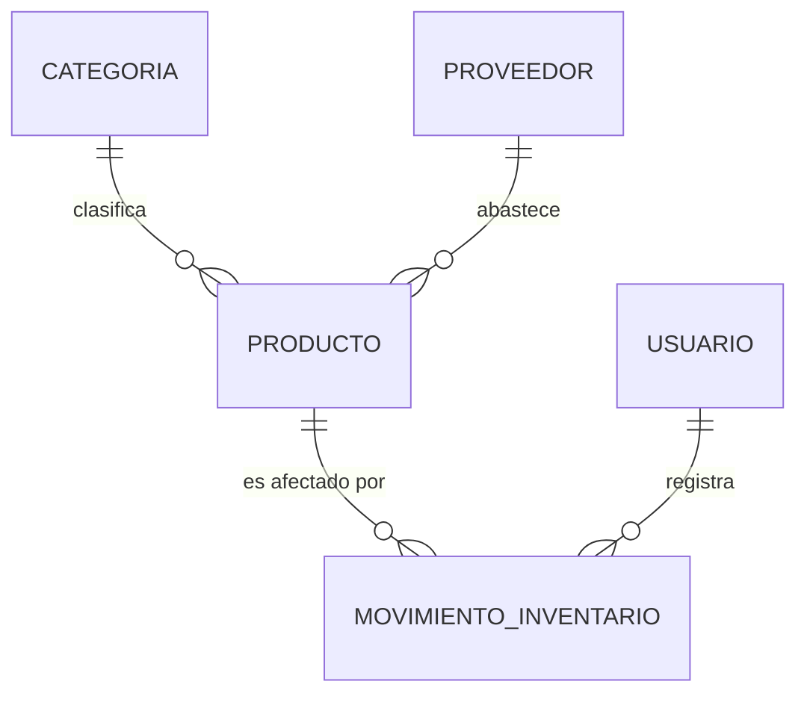
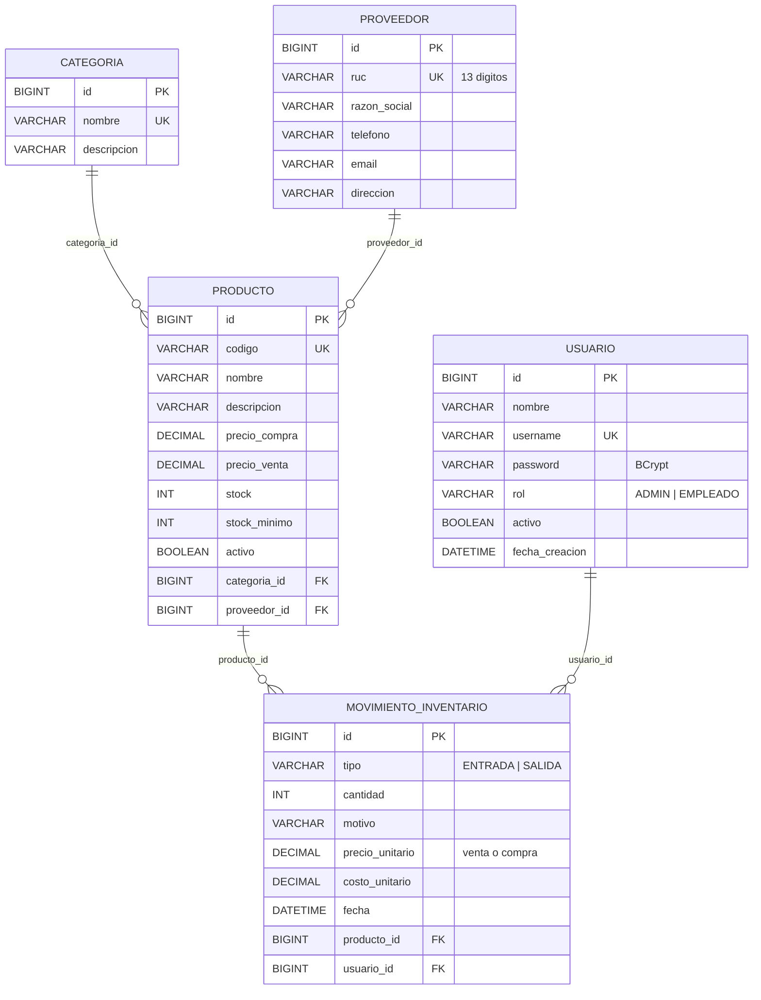

# Sistema de Inventario Comercial

**Examen interciclo – Desarrollo de Aplicaciones Web (Frontend y Backend)**
**Estudiante:** Kevin Stalin Marca Gutama · N.º 15 · Universidad Católica de Cuenca

Aplicación web para controlar el inventario de un comercio: productos, categorías, proveedores y las
entradas/salidas de mercadería, con inicio de sesión y permisos por rol.

| Capa | Tecnología |
|---|---|
| Base de datos | PostgreSQL (administrada con pgAdmin) |
| Backend | Java 17 · Spring Boot 3.3 · Spring Data JPA · Spring Security + JWT · Bean Validation |
| Frontend | React 18 · Vite · React Router |

---

## 1. Análisis del problema

Un comercio necesita saber **qué productos tiene, cuántas unidades hay, a quién se los compra y qué
entró o salió, cuándo y quién lo registró**. Hoy eso se lleva a mano, lo que produce descuadres de stock
y no permite saber cuándo reabastecer.

### Requerimientos funcionales

| Código | Requerimiento |
|---|---|
| RF-01 | Iniciar y cerrar sesión con usuario y contraseña. |
| RF-02 | Controlar permisos por rol: **ADMIN** (todo, incluidos reportes de ganancias) y **EMPLEADO** (registra ventas y entradas, consulta el inventario). |
| RF-03 | Registrar, consultar, actualizar y eliminar **categorías**. |
| RF-04 | Registrar, consultar, actualizar y eliminar **proveedores** (RUC de 13 dígitos, único). |
| RF-05 | Registrar, consultar, actualizar y eliminar **productos**, con categoría, proveedor, precios y stock mínimo. |
| RF-06 | Buscar productos por nombre o código. |
| RF-07 | Registrar **entradas** (compras) y **salidas** (ventas) que actualizan el stock automáticamente. |
| RF-08 | Impedir salidas mayores al stock disponible. |
| RF-09 | Consultar el historial de movimientos (kardex), filtrable por producto, y anular un movimiento revirtiendo el stock. |
| RF-10 | Alertar los productos con stock igual o menor al mínimo. |
| RF-11 | Mostrar un resumen: totales y valor del inventario. |
| RF-12 | Gestionar usuarios (solo ADMIN). |
| RF-13 | Reporte de ventas (solo ADMIN): ventas, unidades, ingresos, ganancia y margen por día, productos más vendidos y ventas por empleado. |

### Reglas de negocio

- El stock **solo cambia por movimientos**; al editar un producto no se toca el stock (así queda historial).
- El precio de venta no puede ser menor al de compra.
- No se elimina una categoría o proveedor con productos, ni un producto o usuario con movimientos (se **desactivan**).
- El usuario que registra un movimiento se toma del **token**, no del formulario (no se puede suplantar).
- Cada movimiento **guarda el precio y el costo del momento** (`precio_unitario`, `costo_unitario`): si mañana cambia el precio, las ventas pasadas y sus ganancias no se alteran.
- Una **venta** es un movimiento de tipo SALIDA. Ganancia = (precio de venta − costo) × cantidad.

---

## 2. Diseño de la base de datos

### Entidades identificadas y por qué

El modelo tiene **5 entidades (tablas)**. Además hay **2 enumeraciones** en Java (`Rol` y `TipoMovimiento`),
que no son tablas sino listas fijas de valores guardadas como texto en `usuario.rol` y `movimiento_inventario.tipo`.


| Entidad | Justificación |
|---|---|
| **Usuario** | Necesaria para la seguridad (login, roles) y para auditar quién registró cada movimiento. |
| **Categoría** | Agrupa productos; se separa para no repetir el nombre en cada producto (normalización) y poder filtrar. |
| **Proveedor** | Un proveedor abastece muchos productos; sus datos (RUC, contacto) no deben repetirse en cada producto. |
| **Producto** | Es el centro del inventario: código, precios, stock actual y stock mínimo. |
| **MovimientoInventario** | Registra cada entrada/salida. Sin esta tabla solo sabríamos el stock actual, no *por qué* cambió. |

### Diagrama entidad-relación



- Una **categoría** clasifica a muchos productos; un producto pertenece a una sola categoría (1:N).
- Un **proveedor** abastece muchos productos; cada producto tiene un proveedor principal (1:N).
- Un **producto** tiene muchos movimientos; cada movimiento afecta a un producto (1:N).
- Un **usuario** registra muchos movimientos; cada movimiento lo registra un usuario (1:N).

### Diagrama de tablas



El script completo está en [`database/inventario_comercial.sql`](database/inventario_comercial.sql).

---

## 3. Backend – API REST

Arquitectura por capas: **Controller → Service → Repository → Base de datos**.

```
backend/src/main/java/com/kevmarca/inventario/
├── config/       SecurityConfig (reglas de acceso, CORS, BCrypt) y DataInitializer (usuarios iniciales)
├── security/     JwtService, JwtAuthFilter, UserDetailsServiceImpl
├── model/        Entidades JPA (tablas)
├── repository/   Interfaces Spring Data JPA (consultas)
├── dto/          Objetos de entrada/salida con validaciones
├── service/      Lógica y reglas de negocio
├── controller/   Endpoints REST
└── exception/    Manejo global de errores en JSON
```

### Endpoints

Todas las rutas (excepto el login) requieren la cabecera `Authorization: Bearer <token>`.

| Método | Ruta | Descripción | Rol |
|---|---|---|---|
| POST | `/api/auth/login` | Inicia sesión, devuelve el token JWT | Público |
| GET | `/api/auth/perfil` | Datos del usuario actual | Autenticado |
| GET | `/api/resumen` | Indicadores del dashboard | Autenticado |
| GET | `/api/categorias` · `/api/categorias/{id}` | Listar / obtener | Autenticado |
| POST · PUT · DELETE | `/api/categorias` · `/api/categorias/{id}` | Crear / actualizar / eliminar | ADMIN |
| GET | `/api/proveedores` · `/api/proveedores/{id}` | Listar / obtener | Autenticado |
| POST · PUT · DELETE | `/api/proveedores` · `/api/proveedores/{id}` | Crear / actualizar / eliminar | ADMIN |
| GET | `/api/productos?buscar=` · `/api/productos/{id}` | Listar (con búsqueda) / obtener | Autenticado |
| GET | `/api/productos/stock-bajo` | Productos por reabastecer | Autenticado |
| POST · PUT · DELETE | `/api/productos` · `/api/productos/{id}` | Crear / actualizar / eliminar | ADMIN |
| GET | `/api/movimientos?productoId=` · `/api/movimientos/{id}` | Historial / obtener | Autenticado |
| POST | `/api/movimientos` | Registrar entrada o salida | Autenticado |
| DELETE | `/api/movimientos/{id}` | Anular (revierte stock) | ADMIN |
| GET | `/api/reportes/ventas?dias=1\|7\|30` | Ventas, ingresos, ganancia y margen del período | ADMIN |
| GET · POST · PUT · DELETE | `/api/usuarios` · `/api/usuarios/{id}` | CRUD de usuarios | ADMIN |

### Códigos de respuesta

`200` OK · `201` creado · `204` eliminado · `400` datos inválidos o regla de negocio · `401` sin sesión ·
`403` sin permiso · `404` no existe · `409` conflicto de integridad.

Ejemplo de error:

```json
{ "estado": 400, "mensaje": "Datos inválidos", "errores": { "ruc": "El RUC debe tener 13 dígitos" } }
```

---

## 4. Frontend

React con páginas para **Dashboard, Productos, Movimientos, Categorías, Proveedores, Reportes y Usuarios**.
Todas consumen la API real mediante `src/api/api.js` (no hay datos simulados).

- **Dashboard:** indicadores, gráfico de entradas/salidas de los últimos 7 días, productos por categoría,
  estado del inventario, productos por reabastecer, últimos movimientos y acciones rápidas
  (gráficos con *Recharts*, íconos con *lucide-react*). Las cifras se calculan con los datos de la API.
- **Reportes (solo ADMIN):** ventas de hoy, 7 o 30 días con ingresos, ganancia, margen, gráfico por día,
  productos más vendidos, ventas por empleado y detalle de cada venta.
- **Dashboard según el rol:** el admin ve *Ventas de hoy* y *Ganancia de hoy*; el empleado ve *Mis ventas de hoy*.
- **Buscador superior** y **campana de notificaciones** con los productos por reabastecer.
- **Diferencias de rol visibles:** el ADMIN trabaja con color rojo y el EMPLEADO con azul; el empleado ve un
  aviso de "Modo empleado", y las acciones que no puede hacer aparecen **bloqueadas con candado**
  (no escondidas), incluidas las opciones *Reportes* y *Usuarios* del menú.

- Validación en el formulario antes de enviar y además muestra los errores que devuelve el backend.
- Si el token expira, se cierra la sesión y vuelve al login.

---

## 5. Cómo ejecutar

### Requisitos
- PostgreSQL + pgAdmin · JDK 17 o superior · Maven (o el soporte Maven de VS Code / IntelliJ) · Node.js 18 o superior

### Paso 1 – Base de datos
1. En **pgAdmin**: clic derecho en *Databases* → *Create* → *Database…* y ponle el nombre `inventario_comercial`.
2. Selecciona esa base, abre **Query Tool** y ejecuta `database/inventario_comercial.sql` (crea las tablas y los datos de prueba).

Los datos de prueba simulan un minimarket de Cuenca: **10 categorías, 7 proveedores, 71 productos,
5 usuarios y 27 movimientos** (entradas y ventas) de los últimos 7 días. Volver a ejecutar el script borra y recrea todo.

### Paso 2 – Backend
La conexión está en `backend/src/main/resources/application.properties`:

```properties
spring.datasource.url=jdbc:postgresql://localhost:5433/inventario_comercial
spring.datasource.username=postgres
```

> Usa el **puerto de tu servidor** de PostgreSQL (en pgAdmin: clic derecho en el servidor → *Properties* → *Connection* → *Port*).
> Por defecto es 5432; en esta computadora PostgreSQL 18 usa el **5433**.

La **contraseña no se sube a GitHub**. Crea el archivo `backend/src/main/resources/application-local.properties`
(está en `.gitignore`) con tu contraseña de PostgreSQL:

```properties
spring.datasource.password=TU_CONTRASEÑA
```

Luego ejecuta:

```bash
cd backend
mvn spring-boot:run
```

Queda en `http://localhost:8080`. Usuarios de prueba (contraseñas guardadas con BCrypt):

| Usuario | Contraseña | Nombre | Rol |
|---|---|---|---|
| `admin` | `admin123` | Kevin Marca | ADMIN |
| `empleado` | `empleado123` | Ana Torres | EMPLEADO |
| `cruiz` | `empleado123` | Carlos Ruiz | EMPLEADO |
| `lgarcia` | `empleado123` | Luis García | EMPLEADO |
| `mpesantez` | `empleado123` | María Pesántez | EMPLEADO (desactivada: no puede ingresar) |

> En Windows, si la ruta de la carpeta tiene tildes (p. ej. `PROGRAMACIÓN`) y `mvn spring-boot:run` falla con
> *Could not find or load main class*, usa: `mvn clean package -DskipTests` y luego `java -jar target\inventario-1.0.0.jar`.

### Paso 3 – Frontend
```bash
cd frontend
npm install
npm run dev
```

Abre `http://localhost:5173`.

### Pruebas sugeridas
1. Ingresar con una contraseña errónea → mensaje de error.
2. Como **admin**: crear categoría, proveedor y producto; editarlos; intentar eliminar una categoría con productos → se bloquea.
3. Registrar una **salida** mayor al stock → se rechaza. Registrar una **entrada** → el stock sube.
4. Anular un movimiento → el stock vuelve a su valor anterior.
5. **Reportes** (admin) → *Hoy* muestra las ventas del día con ingresos y ganancia; cambiar a *Últimos 7 días* muestra el gráfico.
6. Ingresar como **empleado** → la interfaz cambia a azul, aparece el aviso *Modo empleado*, solo consulta y registra movimientos; *Reportes*, *Usuarios* y los botones de crear/editar/eliminar aparecen bloqueados con candado, y si se llama a la API directamente responde 403.
