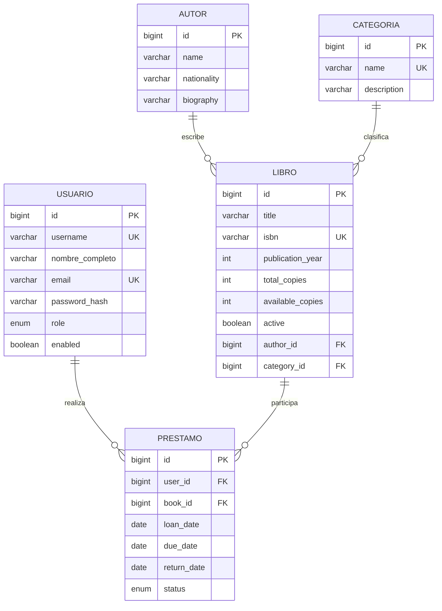
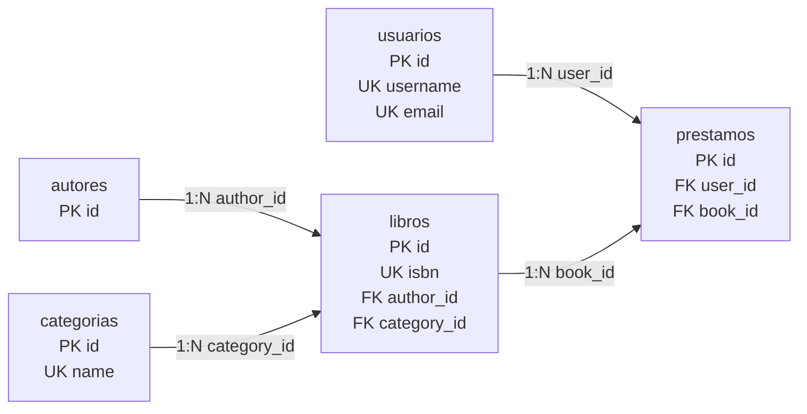
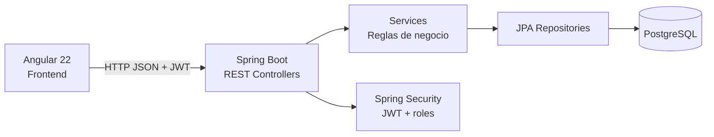

# Análisis y diseño — Gestión de biblioteca

## 1. Problema

Una biblioteca necesita controlar su catálogo, las personas que utilizan el sistema y el ciclo de préstamo/devolución. El problema no se resuelve únicamente almacenando libros: también se debe conocer quién escribió cada obra, cómo se clasifica, cuántos ejemplares están disponibles y qué lector tiene un ejemplar prestado.

## 2. Requerimientos funcionales

1. Autenticar usuarios mediante usuario y contraseña.
2. Registrar lectores desde el frontend.
3. Diferenciar permisos de administrador y lector.
4. Crear, consultar, actualizar y eliminar autores.
5. Crear, consultar, actualizar y eliminar categorías.
6. Crear, consultar, actualizar y eliminar libros.
7. Buscar libros por título o ISBN.
8. Controlar el total de ejemplares y los ejemplares disponibles.
9. Registrar préstamos con fecha de préstamo y fecha límite.
10. Impedir préstamos si no existen ejemplares disponibles.
11. Registrar devoluciones y devolver automáticamente una unidad a disponibilidad.
12. Identificar préstamos activos, vencidos y devueltos.
13. Permitir al administrador administrar usuarios y roles.
14. Permitir a un lector consultar y gestionar únicamente sus propios préstamos.
15. Persistir toda la información en PostgreSQL mediante la API REST.

## 3. Requerimientos no funcionales

- Seguridad basada en JWT y BCrypt.
- Backend sin sesión (`STATELESS`).
- Validación de datos tanto en frontend como en backend.
- API REST organizada por recursos.
- Integridad referencial mediante claves foráneas.
- Interfaz responsiva.
- Manejo uniforme de errores HTTP.
- Separación de responsabilidades: Controller → Service → Repository → Database.

## 4. Entidades identificadas y justificación

### Usuario
Representa a la persona que accede al sistema. Es necesaria porque el examen exige seguridad y control de usuarios, y porque un préstamo debe quedar asociado a un lector concreto.

### Autor
Evita repetir el nombre del autor en cada libro y permite administrar sus datos de manera independiente. La relación con Libro es 1:N.

### Categoría
Normaliza la clasificación de los libros. Una categoría puede clasificar muchos libros; cada libro pertenece a una categoría.

### Libro
Es el recurso central de la biblioteca. Contiene información bibliográfica y de inventario. Se relaciona con Autor y Categoría.

### Préstamo
Representa la operación transaccional del sistema. Une Usuario con Libro y registra las fechas y el estado del préstamo.

## 5. Diagrama entidad-relación

## 6. Diagrama lógico de tablas

## 7. Cardinalidades

- Autor 1:N Libro: un autor puede tener muchos libros.
- Categoría 1:N Libro: una categoría puede contener muchos libros.
- Usuario 1:N Préstamo: un usuario puede realizar múltiples préstamos.
- Libro 1:N Préstamo: un libro puede aparecer en muchos préstamos a lo largo del tiempo.
- Usuario N:M Libro se resuelve indirectamente mediante Préstamo, que además almacena datos propios de la relación.

## 8. Reglas de negocio

- ISBN único.
- Username y email únicos.
- No se presta un libro inactivo.
- No se presta un libro sin unidades disponibles.
- Un usuario no puede tener dos préstamos activos del mismo libro.
- Al prestar: `availableCopies = availableCopies - 1`.
- Al devolver: `availableCopies = availableCopies + 1` sin superar `totalCopies`.
- No se puede reducir `totalCopies` por debajo del número de unidades actualmente prestadas.
- No se puede eliminar un libro con préstamos activos.
- El rol LECTOR no puede ejecutar CRUD administrativo.
- Los lectores solo ven sus préstamos; ADMIN ve todos.

## 9. Arquitectura

## 10. Justificación técnica

PostgreSQL se utiliza por ser una base relacional adecuada para relaciones, restricciones e integridad referencial. Spring Boot permite separar controladores, servicios y repositorios, mientras Spring Security protege la API. Angular consume la API mediante `HttpClient`, incorpora el token JWT a cada petición con un interceptor y protege rutas con guards.
