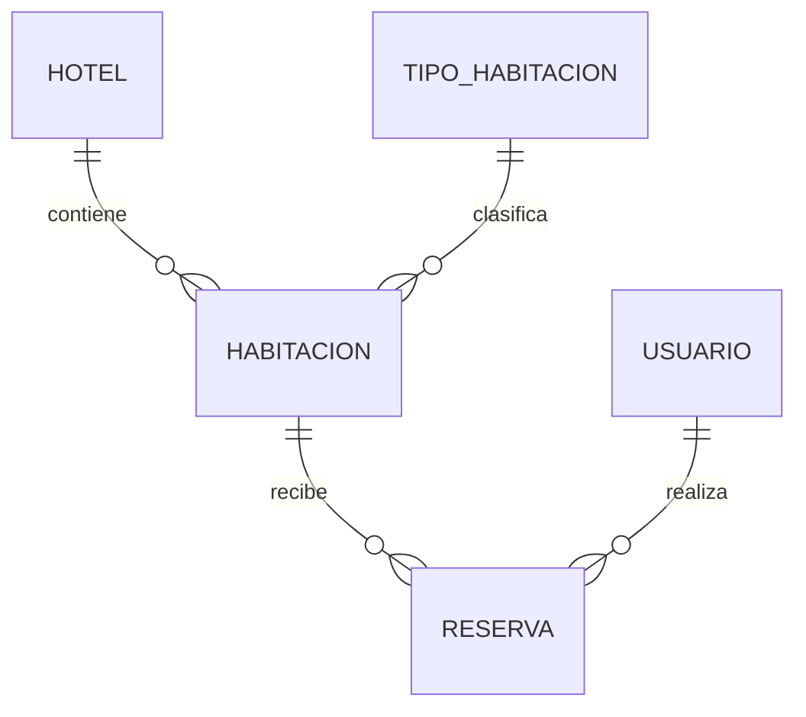
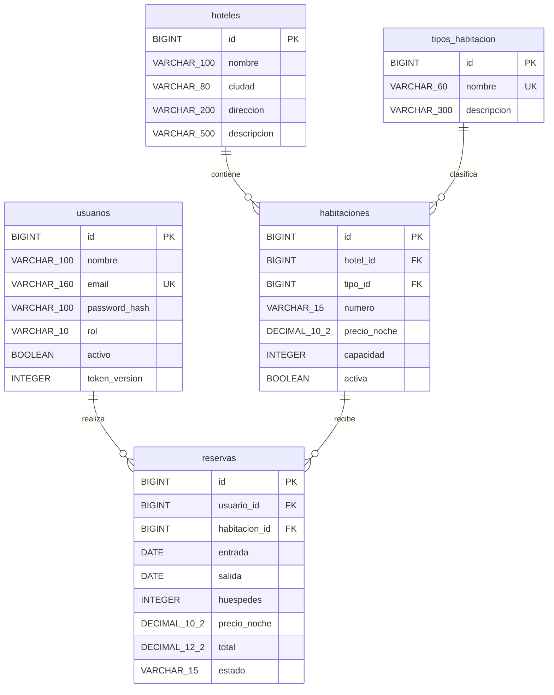

# Diseño — Reservas hoteleras
**Estudiante:** Danny Salazar · Rama: estudiante-danny-salazar

## Problema y alcance
Gestionar habitaciones de hoteles y sus reservas evitando fechas incompatibles, datos duplicados y acceso a reservas ajenas. Un huésped consulta disponibilidad, reserva y administra sus estancias desde Angular. El administrador mantiene los catálogos y supervisa todas las reservas.

## Requerimientos
Registro y login, roles ADMIN/USUARIO, CRUD de hoteles/tipos/habitaciones/reservas, búsqueda de disponibilidad por entrada/salida/capacidad, cálculo del total, cancelación, control de propiedad y desactivación de usuarios. Los registros provienen de la API y MariaDB; no se utiliza una lista simulada en Angular.

## Entidades y justificación
|Entidad|Por qué existe|Relaciones|
|---|---|---|
|Hotel|Almacena ubicación y datos comunes una sola vez|Un hotel tiene muchas habitaciones|
|TipoHabitacion|Reutiliza una clasificación como Individual, Doble o Familiar|Un tipo clasifica muchas habitaciones|
|Habitacion|Unidad reservable: número, tarifa, capacidad y habilitación|Pertenece a un hotel y un tipo; recibe muchas reservas|
|Reserva|Registra quién ocupa qué habitación, cuándo y por cuánto|Pertenece a un usuario y una habitación|
|Usuario|Identidad, credenciales y rol|Puede efectuar muchas reservas|

No se crea otra tabla Cliente: el usuario registrado es el titular de la reserva. No se crea una tabla Rol porque solo hay dos valores fijos sin atributos propios. Una reserva no contiene varias habitaciones: para ese caso se registran reservas separadas.

## Diagrama entidad-relación

También disponible como `ER.svg`, que se puede abrir directamente en el navegador.

## Diagrama de tablas

También disponible como `TABLAS.svg`. El SQL completo, con restricciones y tipos exactos, está en `database/schema.sql` y su copia ejecutable en recursos del backend. La tabla técnica inicializacion marca la carga inicial y no forma parte de las cuatro entidades del negocio.

## Integridad y reglas
- PK BIGINT autoincrementales. FK obligatorias y sin borrado en cascada: se rechaza borrar un catálogo utilizado.
- Email y nombre de tipo únicos. Número de habitación único dentro de cada hotel (hotel_id,numero).
- Precios DECIMAL, no float. Capacidad 1–20, tarifa positiva, salida posterior a entrada.
- Registro público siempre USUARIO: un cliente HTTP no puede elegir ADMIN.
- JWT firmado HS256, una hora; BCrypt costo 12 para contraseñas. No se retornan hashes al frontend.
- Cada solicitud protegida comprueba token y usuario vigente. Guards y botones Angular ayudan a navegar; no sustituyen el backend.
- Total y usuario_id se determinan en el servidor. El formulario no decide el precio ni a quién atribuir la reserva.
- Reserva confirmada ocupa [entrada,salida). Conflicto si existente.entrada < nueva.salida y existente.salida > nueva.entrada.
- Se bloquea la habitación con SELECT FOR UPDATE dentro de una transacción READ_COMMITTED para serializar reservas simultáneas. No basta comprobar disponibilidad en Angular.
- Se rechazan fechas pasadas, estancias de más de 365 noches, exceso de capacidad y habitaciones fuera de servicio.
- Modificar mantiene la habitación; para cambiarla se cancela y crea otra reserva. No se editan reservas canceladas ni iniciadas en días anteriores.
- Cancelar libera fechas. Eliminar requiere cancelación previa y permiso de propietario o ADMIN. No se simulan pagos.
- Desactivar un usuario impide login y revoca sus JWT, pero no cancela sus reservas automáticamente; ADMIN las gestiona.

## Normalización
Hotel, tipo y usuario se referencian por ID en lugar de repetir sus datos en cada reserva. La tarifa guardada en Reserva es histórica y distinta de la tarifa vigente de Habitacion. El total es un valor calculado almacenado deliberadamente y actualizado solo por el servicio de reservas, para conservar el importe acordado. No se afirma una ausencia absoluta de redundancia.

## Arquitectura
Angular → HTTP/JSON → Controller → Service → Consultas/JdbcTemplate → MariaDB.
El filtro JWT interviene antes de los controladores. La pantalla envía IDs de relaciones; la base impone FK. No se usan microservicios, JPA ni Gmail para este alcance.

## Endpoints
Todos tienen prefijo /api. Login, registro y health son públicos; el resto requiere Bearer token.
|Recurso|Operaciones|Acceso|
|---|---|---|
|/auth/registro|POST|Público, crea USUARIO|
|/auth/login|POST|Público, devuelve token y usuario|
|/auth/me|GET|Autenticado|
|/auth/logout|POST|Autenticado, revoca tokens|
|/hoteles y /hoteles/{id}|GET, POST, PUT, DELETE|Lectura autenticada; escritura ADMIN|
|/tipos y /tipos/{id}|GET, POST, PUT, DELETE|Lectura autenticada; escritura ADMIN|
|/habitaciones y /habitaciones/{id}|GET, POST, PUT, DELETE|Lectura autenticada; escritura ADMIN|
|/habitaciones?entrada=AAAA-MM-DD&salida=AAAA-MM-DD&huespedes=2|GET|Disponibilidad autenticada|
|/reservas y /reservas/{id}|GET, POST, PUT, DELETE|USUARIO propias; ADMIN todas. POST atribuye al usuario actual|
|/reservas/{id}/cancelar|PATCH|Propietario o ADMIN|
|/usuarios|GET|ADMIN|
|/usuarios/{id}/activo|PATCH|ADMIN, no desactiva al ADMIN inicial|
|/health|GET|Público|
POST CRUD:201; GET/PUT:200; DELETE/cancelar/logout/activo:204; datos inválidos:400; sin sesión:401; sin permiso:403; no existe:404; conflicto:409.
