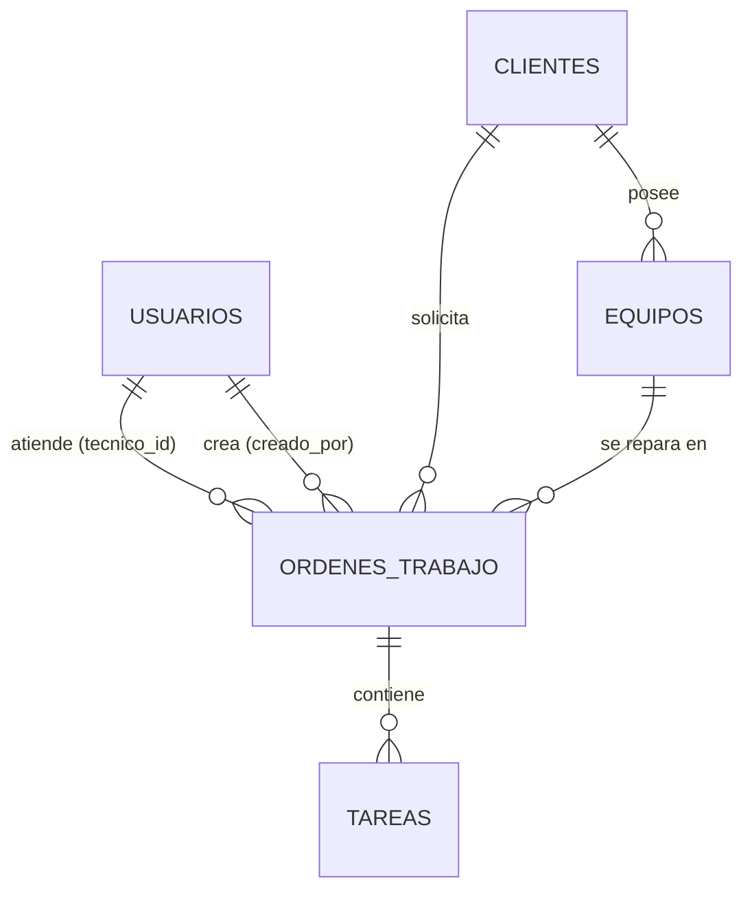
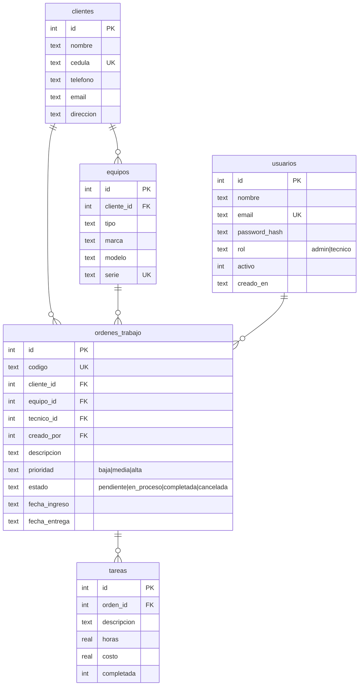

# Control de Órdenes de Trabajo — Diseño

**Estudiante:** Rafael Sebastián Rivas Carmona (17) · Rama `estudiante-17-rafael-rivas`

## Requerimientos funcionales
- Autenticación con roles: **admin** (gestiona todo) y **técnico** (solo ve/actualiza sus órdenes).
- CRUD de clientes, equipos, órdenes de trabajo, tareas de una orden y usuarios.
- Asignar técnico a una orden, cambiar estado y prioridad, filtrar/buscar órdenes.
- Costo total de una orden = suma del costo de sus tareas.

## Diagrama entidad-relación


## Diagrama de tablas


## Justificación de entidades y relaciones
- **usuarios**: quien opera el sistema; el campo `rol` separa permisos (admin/técnico). El técnico es un usuario, no otra tabla, para no duplicar credenciales.
- **clientes**: quien solicita el trabajo; datos se guardan una sola vez aunque tenga muchas órdenes.
- **equipos**: un cliente tiene varios equipos (1:N). Se separa para no repetir marca/modelo/serie en cada orden y conservar el historial por equipo.
- **ordenes_trabajo**: entidad central; une cliente, equipo y técnico. Las FK a cliente/equipo son `RESTRICT` (no se borra un cliente con órdenes, se preserva el historial); el técnico es `SET NULL`.
- **tareas**: detalle de lo realizado (1:N con la orden, `CASCADE`). Evita una columna de costo fija y permite calcular el total con `SUM`.
- Normalización 3FN: cada dato depende solo de la clave de su tabla. Validación extra en la API: el equipo debe pertenecer al cliente de la orden.

## Seguridad
- Contraseñas con **bcrypt** (hash con sal), nunca en texto plano.
- Sesión con **JWT** (8 h) en `Authorization: Bearer`.
- Middleware `requiereAuth` (todas las rutas excepto login) y `requiereRol('admin')` para escritura de catálogos/usuarios.
- El técnico solo accede a sus órdenes y solo puede cambiar el estado (comprobado en backend, no solo en la interfaz).
- Consultas SQL parametrizadas (previene inyección SQL); el frontend escapa HTML (previene XSS).

## API REST (prefijo `/api`)
| Recurso | Métodos | Rol |
|---|---|---|
| `/auth/login` | POST | público |
| `/usuarios`, `/usuarios/:id` | GET, POST, PUT, DELETE | admin |
| `/tecnicos` | GET | autenticado |
| `/clientes`, `/clientes/:id` | GET (todos) · POST, PUT, DELETE (admin) | |
| `/equipos`, `/equipos/:id` | GET (todos) · POST, PUT, DELETE (admin) | |
| `/ordenes`, `/ordenes/:id` | GET (técnico: solo las suyas) · POST, DELETE (admin) · PUT (admin completo; técnico solo estado) | |
| `/ordenes/:id/tareas`, `/tareas/:id` | POST, PUT, DELETE | admin o técnico asignado |
| `/resumen` | GET | autenticado |

Códigos: 200/201 éxito, 400 validación, 401 sin sesión, 403 sin permiso, 404 no existe, 409 duplicado o relación existente.

## Ejecución
```bash
cd backend
npm install
npm start          # http://localhost:3000  (crea database/ordenes.db desde database/schema.sql)
```
Usuario inicial: `admin@ordenes.com` / `admin123`. El frontend (carpeta `frontend/`) lo sirve el mismo Express.
