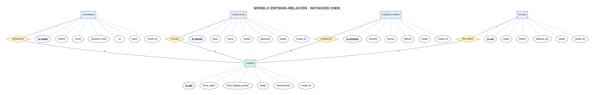
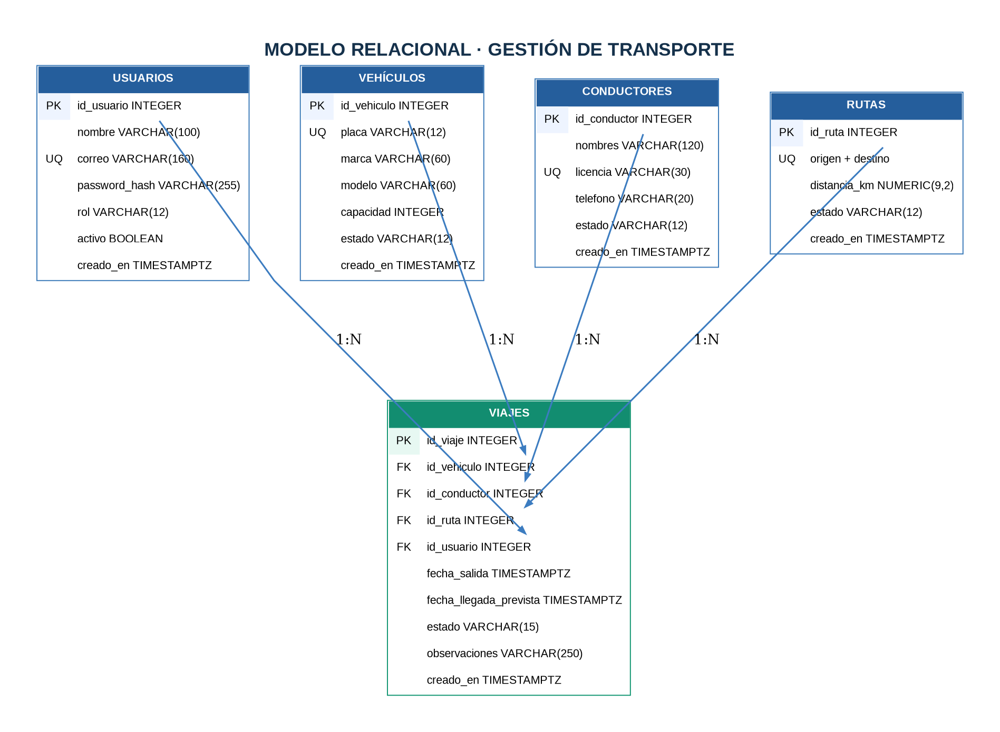

# Análisis funcional y diseño de información

**Sistema:** RutaControl — Gestión de Transporte  
**Responsable:** Geovanny Alejandro Santacruz Gavilanez  
**Alcance:** aplicación web individual con base de datos relacional, API REST y frontend.

## 1. Problema

Una empresa de transporte necesita registrar vehículos, conductores y rutas, programar viajes y controlar quién puede actualizar la información. Si utiliza documentos separados, puede duplicar placas o licencias, asignar el mismo conductor a viajes simultáneos y perder trazabilidad sobre las programaciones. Se propone una solución web centralizada.

## 2. Objetivo

Implementar una aplicación con almacenamiento persistente en PostgreSQL, backend REST en Node.js/Express y frontend en HTML/CSS/JavaScript, incorporando autenticación, roles, validación de datos y operaciones CRUD.

## 3. Requerimientos funcionales

| Código | Comportamiento esperado |
| --- | --- |
| RF-01 | Iniciar sesión mediante correo y contraseña. |
| RF-02 | Registrar, consultar, editar y eliminar vehículos. |
| RF-03 | Registrar, consultar, editar y eliminar conductores. |
| RF-04 | Registrar, consultar, editar y eliminar rutas. |
| RF-05 | Registrar, consultar, editar y eliminar viajes. |
| RF-06 | Asignar exactamente un vehículo, un conductor, una ruta y un usuario responsable por viaje. |
| RF-07 | Impedir asignaciones superpuestas del mismo conductor o vehículo. |
| RF-08 | Consultar un resumen de cantidades y estados. |
| RF-09 | Administrar cuentas con roles y estado activo/inactivo. |
| RF-10 | Validar entradas y presentar errores comprensibles. |

## 4. Requerimientos no funcionales

- RNF-01: persistencia real en PostgreSQL, sin catálogos simulados en el frontend.
- RNF-02: API JSON bajo `/api` con respuestas y códigos HTTP adecuados.
- RNF-03: interfaces adaptables a escritorio, tablet y móvil.
- RNF-04: contraseñas no reversibles almacenadas con bcrypt y control de sesión con JWT.
- RNF-05: consultas parametrizadas para reducir riesgo de inyección SQL.
- RNF-06: separación física y lógica de frontend, backend, scripts SQL y documentación.
- RNF-07: restricciones de integridad tanto en servidor como en base de datos.

## 5. Entidades y atributos

| Entidad | Clave primaria | Atributos relevantes | Restricciones |
| --- | --- | --- | --- |
| usuarios | id_usuario | nombre, correo, password_hash, rol, activo, creado_en | correo único; rol admin/operador |
| vehiculos | id_vehiculo | placa, marca, modelo, capacidad, estado, creado_en | placa única; capacidad 1..120 |
| conductores | id_conductor | nombres, licencia, telefono, estado, creado_en | licencia única |
| rutas | id_ruta | origen, destino, distancia_km, estado, creado_en | origen distinto a destino, combinación única |
| viajes | id_viaje | id_vehiculo, id_conductor, id_ruta, id_usuario, fechas, estado, observaciones, creado_en | cuatro claves foráneas; llegada después de salida |

## 6. Relaciones y cardinalidades

- **Usuarios (1) — (N) Viajes.** El usuario que registra un viaje queda relacionado con él mediante `viajes.id_usuario`.
- **Vehículos (1) — (N) Viajes.** El vehículo participa en diferentes viajes a lo largo del tiempo, pero un viaje tiene exactamente un vehículo.
- **Conductores (1) — (N) Viajes.** Un conductor puede trabajar en diferentes viajes sin solapamiento de horarios.
- **Rutas (1) — (N) Viajes.** Una ruta se reutiliza para muchas programaciones.

Se separan los catálogos de la tabla de viajes para evitar repetir datos de placa, licencia y trayecto en cada viaje. La relación N:M entre vehículos y rutas se resuelve indirectamente mediante la entidad de viajes, que registra cada evento específico.

### Diagramas

## 7. Reglas de negocio

1. `placa`, `licencia` y `correo` son únicos.
2. Capacidad y distancia son positivas.
3. Origen y destino no pueden ser iguales.
4. Fecha de llegada prevista posterior a salida.
5. Un viaje programado o en curso necesita vehículo, conductor y ruta activos.
6. Un conductor o vehículo no puede figurar en dos viajes programados/en curso con intervalos superpuestos. La validación se ejecuta dentro de una transacción y utiliza bloqueos por recurso.
7. No se borran vehículos, conductores, rutas o usuarios si poseen viajes relacionados (integridad referencial).
8. `admin` gestiona catálogos, usuarios y todos los viajes; `operador` consulta catálogos y gestiona viajes.
9. No es posible eliminar la propia cuenta administrativa ni desactivar al último administrador activo.

## 8. Arquitectura

**Capa de presentación:** `frontend/index.html`, estilos, scripts ES Modules. Formularios y tablas dinámicos; consumo de servicios mediante `fetch`.

**Capa de negocio:** servidor Express con middleware JWT, permisos, validaciones y rutas independientes. El servidor entrega también los archivos estáticos sin mezclar código de interfaz en los controladores.

**Capa de datos:** PostgreSQL, con PK/FK, índices y CHECK/UNIQUE. `pg.Pool` administra las conexiones; SQL parametrizado separa instrucciones de valores de entrada.

**Flujo:** Navegador → petición HTTP con JWT → middleware de permisos → validación → consulta parametrizada PostgreSQL → respuesta JSON → actualización visual.

## 9. Operaciones CRUD

Cada recurso dispone de `GET /`, `GET /:id`, `POST /`, `PUT /:id`, `DELETE /:id`. La API devuelve 201 al crear, 400 si el formato es inválido, 401 sin sesión, 403 sin permisos, 404 si no existe y 409 en conflictos o restricciones de integridad.

## 10. Criterios de integridad

- El usuario creador de un viaje se fija según la sesión y **no** se acepta del cuerpo enviado por el navegador.
- Los IDs de las entidades se validan como enteros positivos.
- Si una operación de viaje falla, se revierte la transacción.
- Se aplican validaciones HTML5 en formularios y validación adicional en backend; la base de datos funciona como defensa final.
